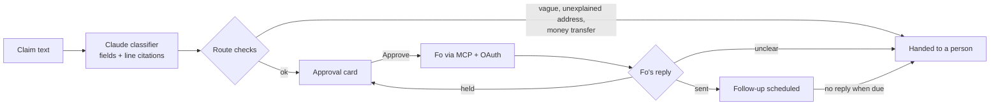

# Fo Claims Agent

[](https://github.com/DHYEY166/fo-claims-agent/actions/workflows/ci.yml)

A Fo agent that files card disputes and insurance or package claims for you and tracks each case until it's resolved, asking before every follow-up.

Built for the Wajo GSD hackathon on [Fo](https://wajo.ai), Wajo's action agent, with Claude.

**Demo video:** link coming Monday, Oct 19. <!-- DEMO_LINK -->

## Why it matters

Getting money back is tedious. You have to find the receipt, work out who to contact, write the email, keep track of the deadline and chase the reply. Plenty of people never bother, even when they're owed the money. Fo can already make calls and send emails for you. This project adds what a claim needs on top of that: a case file, evidence for every field, and a person approving every message before Fo sends it.

## What it does

1. **Takes the claim.** You paste the email or describe what happened in the web dashboard.
2. **Builds a case.** Claude reads it and fills in a case: the kind of claim (card dispute, insurance or package), who to contact, the amount, the merchant, the date and the order number. Each field cites the line it came from, the filing deadline is computed in code instead of guessed, and card numbers are masked before anything is stored.
3. **Stops when it should.** A claim that's too vague, an email address nothing in the claim explains, or a request to move money sends the case to a person instead of moving ahead.
4. **Asks before acting.** Every outbound email shows up as an approval card: who Fo will contact, what it will say, and what it costs. Nothing goes out until you click Approve.
5. **Sends through Fo.** The approved email goes out through Fo's MCP server, which this app connects to over OAuth. The agent reads Fo's reply and marks the email sent only when Fo confirms it. If Fo holds the email for a second go-ahead, the card says so. If Fo's reply is unclear, the case goes to a person and is never marked sent.
6. **Tracks the case.** After sending, it schedules a follow-up. If the bank doesn't answer, it flags the case for you, and any follow-up needs your approval again.

Every outbound action, plus the follow-up, the reply and the resolution, goes into an audit log where each entry is chained to the one before it.

## How it works



- `api/`: FastAPI backend with SQLite. It holds the classifier (prompt `api/prompts/classify.v2.md`), the pipeline and its route checks, the Fo client and OAuth flow, and webhook signature checks.
- `trust/`: the approval gate, redaction, and the hash-chained audit log.
- `web/`: Next.js dashboard (case list, new claim, case timeline with approval cards, audit log). It runs against the real backend or an in-memory mock that shows a MOCK DATA badge.
- `tests/`: trust and safety tests. `docs/`: the trust spec, demo script and story docs.

## Trust and safety

<!-- TRUST_SECTION: written by fo trust qa. Paste their section here exactly as worded. -->
_This section comes from our trust and QA work and is being finalized. See [docs/TRUST_SPEC.md](docs/TRUST_SPEC.md) for now._

## Setup

You need Python 3 and Node.js. Everything runs locally.

```bash
git clone https://github.com/DHYEY166/fo-claims-agent.git
cd fo-claims-agent
cp api/.env.example .env      # the backend reads .env from the repo root; never commit it
```

Leave `FO_MOCK=1` to try it without any keys. Fo is simulated, and every simulated event is marked mock.

```bash
# backend on :8000
cd api
python3 -m venv .venv && .venv/bin/pip install -r requirements.txt
.venv/bin/uvicorn app.main:app --port 8000

# dashboard on :3100, in a second terminal
cd web
npm install
NEXT_PUBLIC_API_BASE=http://localhost:8000 npm run dev
```

Run `npm run dev` without `NEXT_PUBLIC_API_BASE` to get the dashboard's built-in mock data and skip the backend entirely.

**Using real Fo.** Set `ANTHROPIC_API_KEY`, set `FO_TEST_TARGET` to a test inbox you own (it's the only address Fo will ever be asked to contact), set `FO_MOCK=0`, then open `http://localhost:8000/oauth/start` to connect your Fo account. Tokens are written only to the gitignored `.env`. Real sends are capped at 3 a day in code (`MAX_TEST_SENDS_PER_DAY`).

## Tests

71 automated tests pass in CI (mock mode). To run them from the repo root:

```bash
pip install -r api/requirements.txt -r tests/trust/requirements.txt
python -m pytest -q --ignore=tests/trust/test_api_live.py
```

## License

MIT. See [LICENSE](LICENSE).
