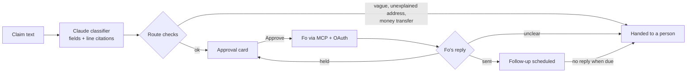

# Fo Claims Agent

[](https://github.com/DHYEY166/fo-claims-agent/actions/workflows/ci.yml)

A Fo agent that files card disputes and insurance or package claims for you and tracks each case until it's resolved, asking before every follow-up.

Built for the Wajo GSD hackathon on [Fo](https://wajo.ai), Wajo's action agent, with Claude.

**Demo video:** link coming Monday, Oct 19. <!-- DEMO_LINK -->

## Why it matters

Getting money back is tedious. You have to find the receipt, work out who to contact, write the email, keep track of the deadline and chase the reply. Plenty of people never bother, even when they're owed the money. Fo can already make calls and send emails for you. This project adds what a claim needs on top of that: a case file, evidence for every field, and a person approving every message before Fo sends it.

## What it does

1. **Takes the claim.** You paste the email or describe what happened in the web dashboard.
2. **Builds a case.** Claude reads it and fills in a case: the kind of claim (card dispute, insurance or package), who to contact, the amount, the merchant, the date and the order number. Each field cites the line it came from, the filing deadline is computed in code instead of guessed, and card numbers are masked before anything is stored.
3. **Stops when it should.** A claim that's too vague, an email address nothing in the claim explains, or a request to move money sends the case to a person instead of moving ahead.
4. **Asks before acting.** Every outbound email shows up as an approval card: who Fo will contact, what it will say, and what it costs. Nothing goes out until you click Approve.
5. **Sends through Fo.** The approved email goes out through Fo's MCP server, which this app connects to over OAuth. The agent reads Fo's reply and marks the email sent only when Fo confirms it. If Fo holds the email for a second go-ahead, the card says so. If Fo's reply is unclear, the case goes to a person and is never marked sent.
6. **Tracks the case.** After sending, it schedules a follow-up. If the bank doesn't answer, it flags the case for you, and any follow-up needs your approval again.

Every outbound action, plus the follow-up, the reply and the resolution, goes into an audit log where each entry is chained to the one before it.

## How it works



- `api/`: FastAPI backend with SQLite. It holds the classifier (prompt `api/prompts/classify.v2.md`), the pipeline and its route checks, the Fo client and OAuth flow, and webhook signature checks.
- `trust/`: the approval gate, redaction, and the hash-chained audit log.
- `web/`: Next.js dashboard (case list, new claim, case timeline with approval cards, audit log). It runs against the real backend or an in-memory mock that shows a MOCK DATA badge.
- `tests/`: trust and safety tests. `docs/`: the trust spec, demo script and story docs.

## Trust by design

The agent drafts and reasons, but code decides what is allowed to leave the computer. Every rule below lives in `trust/` and `api/app/pipeline.py`, not in a prompt, and each one has a test.

**You approve every outbound action.** Nothing goes to Fo until you click Approve on the exact email the agent drafted. The approval is tied to a hash of the case, the action, the recipient and the message text. If any of those change after you approve, the send is refused (`action_changed_after_approval`). An approval works once (a second use gets 409) and expires after 15 minutes. Reject stops the case before Fo is ever contacted.

**Email only, to one allowed inbox.** For the demo the agent can email exactly one address: our own private test bank inbox. Phone calls and every other recipient are blocked by the trust gate, and the block is written to the audit log. The real address is kept only in `.env`. The dashboard, the database, the audit log and the API all show an alias instead. The address is swapped in only in the one outbound message to Fo.

**No money moves.** The spend limit is \$0, so any action that tries to spend is blocked. The agent never asks Fo for a single-use card. A separate hard cap allows at most 3 real emails to the test bank inbox per UTC day, and each approved case gets one send with no automatic retries.

**An audit log where each entry is chained to the one before it.** Each of these is logged as a row in an append-only SQLite log: intake, classification, approval requested, your decision, the send authorization, the Fo request, follow-up scheduled, reply received and resolution. Blocks and escalations get rows too. Each row is hash-chained to the one before it. The database refuses edits and deletes, and if someone gets around that and changes a row, the chain check fails. An end-to-end test (`tests/trust/test_audit_chain_e2e.py`) runs a real case through the API and confirms all of this. The one step without a row is evidence gathering, which is internal and sends nothing.

**Forwarded emails are treated as data, not instructions.** Pasted or forwarded text reaches the model wrapped as untrusted input. If the model reports that the text tries to instruct the agent, the case goes to a human. Code also checks the raw text, without relying on the model, for email addresses or money-transfer instructions (wire, Zelle, gift cards, crypto and similar) that the claim doesn't explain, and escalates if it finds any. After Fo's turn, the agent checks Fo's conversation for any recipient besides the allowed inbox. If it finds one, the case is marked failed.

**PII stays out of storage.** Card numbers, SSNs and API keys are redacted before the claim text is saved. Email addresses are masked in the database, the API and server logs. Only the last 4 digits of a card are kept.

**Locked to this computer.** Fo sign-in and the approve and reject routes only answer a browser on this machine. Requests through a proxy or tunnel (forwarded headers, or a Host other than localhost) get 403.

**Signed webhooks.** Fo webhooks are verified with Standard Webhooks HMAC signatures, which allow 5 minutes of clock skew. Duplicate webhook ids are ignored, and an unsigned or badly signed request gets 401.

**When unsure, it hands off to a person.** The case goes to a human, not to the bank, in any of these situations:
- Classifier confidence is below 0.7.
- The claim type is out of scope.
- The filing window has closed.
- The case passed its model token budget.
- Fo asks a question.
- Fo says it is holding the email for a go-ahead.
- The daily cap is reached.
- A follow-up comes due with no reply.

A follow-up never contacts the bank on its own. Another send needs another approval.

**Honest failure states.** The dashboard says what actually happened:
- If Fo's reply doesn't clearly say the email went out, the case says "Couldn't confirm Fo sent the email" and no follow-up is scheduled.
- If Fo is still working after 10 minutes, the case escalates.
- If Fo's turn fails, the case is marked failed.
- If a case sits in contacting for 15 minutes with no result, it escalates.

Mock mode is always labeled MOCK.

## Setup

You need Python 3 and Node.js. Everything runs locally.

```bash
git clone https://github.com/DHYEY166/fo-claims-agent.git
cd fo-claims-agent
cp api/.env.example .env      # the backend reads .env from the repo root; never commit it
```

Leave `FO_MOCK=1` to try it without any keys. Fo is simulated, and every simulated event is marked mock.

```bash
# backend on :8000
cd api
python3 -m venv .venv && .venv/bin/pip install -r requirements.txt
.venv/bin/uvicorn app.main:app --port 8000

# dashboard on :3100, in a second terminal
cd web
npm install
NEXT_PUBLIC_API_BASE=http://localhost:8000 npm run dev
```

Run `npm run dev` without `NEXT_PUBLIC_API_BASE` to get the dashboard's built-in mock data and skip the backend entirely.

**Using real Fo.** Set `ANTHROPIC_API_KEY`, set `FO_TEST_TARGET` to a test inbox you own (it's the only address Fo will ever be asked to contact), set `FO_MOCK=0`, then open `http://localhost:8000/oauth/start` to connect your Fo account. Tokens are written only to the gitignored `.env`. Real sends are capped at 3 a day in code (`MAX_TEST_SENDS_PER_DAY`).

## Tests

78 automated tests pass in CI (mock mode). To run them from the repo root:

```bash
pip install -r api/requirements.txt -r tests/trust/requirements.txt
python -m pytest -q --ignore=tests/trust/test_api_live.py
```

## License

MIT. See [LICENSE](LICENSE).
